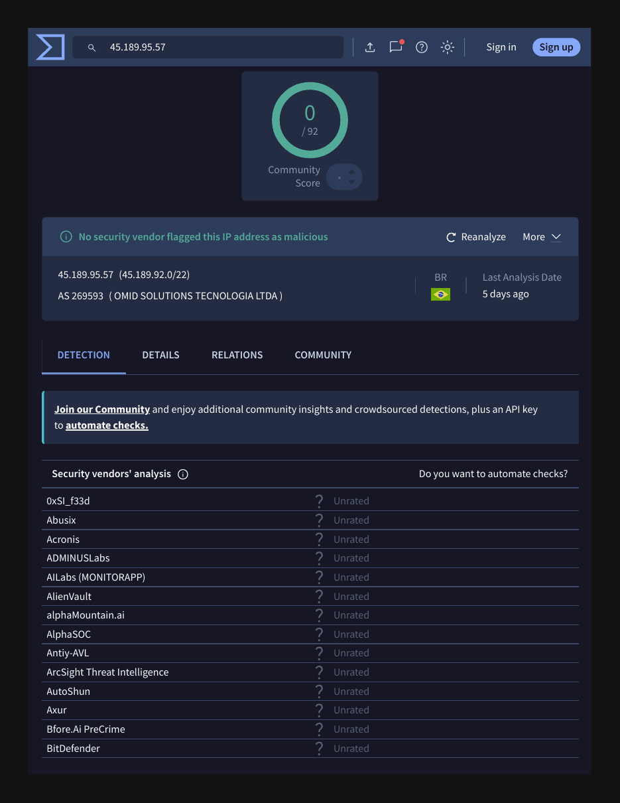

# Phishing Report 01: Dieter Schwarz Donation Scam

| Field | Value |
|---|---|
| Sample | `sample-7712.eml` (phishing_pot dataset) |
| Date received | 10 Feb 2026 10:17:24 -0800 |
| Category | Advance-fee / donation scam |
| Verdict | **Malicious** |
| Severity | Medium (social engineering, no payload) |
| Impersonates | Dieter Schwarz (Lidl / Schwarz Group owner) |
| Campaign | Same campaign as [report 03](email-03.md) |
| Analyst | Satvik Huse |

## 1. Summary
An unsolicited email claiming to be from billionaire Dieter Schwarz, sent from a genuine Brazilian company mailbox that appears to be compromised. Replies are redirected to a Gmail address controlled by the attacker. There are no links or attachments: the goal is to start a conversation and later ask for fees or personal data.

## 2. Header analysis
| Header | Value | Finding |
|---|---|---|
| From | edmilson.oliveira@minc.ind.br | Legitimate business domain |
| Return-Path | edmilson.oliveira@minc.ind.br | Matches From |
| Reply-To | schwarzdieter709@gmail.com | **Mismatch**: free Gmail, attacker-controlled |
| Subject | AW: Mein Name ist Dieter Schwarz. | Fake "AW:" (German "Re:") to look like a reply |
| Sending server | webmail.minc.omid.com.br [45.189.95.57] | The company's own webmail |
| SPF / DKIM / DMARC | pass / pass / pass | Sent from the domain's real server |

## 3. Enrichment
| Indicator | Tool | Result |
|---|---|---|
| 45.189.95.57 | VirusTotal (re-checked 2026-10-18) | 0/92; AS269593 OMID Solutions Tecnologia, Brazil |
| 45.189.95.57 | AbuseIPDB | No abuse reports |
| minc.ind.br | urlscan.io | Real 6-year-old business site, Hostinger, São Paulo |
| URLs / attachments | grep | None found |

The IP belongs to the same provider as the webmail hostname (OMID), which supports the view that the real mailbox was used, not a spoofed one.

## 4. IOCs
| Type | Value | Action |
|---|---|---|
| Email (Reply-To) | schwarzdieter709@gmail.com | Block (primary IOC) |
| Email (sender) | edmilson.oliveira@minc.ind.br | Monitor: likely compromised |
| IP | 45.189.95.57 | Watchlist only: legitimate mail server |

## 5. Red flags
- Reply-To differs from From and uses free Gmail
- Unknown sender claiming to be a famous billionaire
- Fake reply prefix suggests an existing conversation
- German subject from a Brazilian domain

## 6. MITRE ATT&CK
| Technique | ID | Why |
|---|---|---|
| Phishing | T1566 | Social-engineering email to start a scam |
| Valid Accounts | T1078 | A real mailbox appears to have been used to send |

## 7. Recommended actions
1. Block and quarantine mail with Reply-To schwarzdieter709@gmail.com across all mailboxes
2. Do not block minc.ind.br (legitimate business); watchlist 45.189.95.57
3. Report as phishing; notify minc.ind.br that the account appears compromised
4. If any user replied, find out what they shared and alert them

## 8. Evidence

*VirusTotal, 2026-10-18: no vendor flags the sending IP.*

*urlscan.io, 2026-10-14: minc.ind.br loads a real industrial-engineering company site in Brazil (no classification). [Full scan](https://urlscan.io/result/01a13a1a-22c1-7674-9296-41d989333c71/)*

## 9. Lesson learned
SPF, DKIM and DMARC passing only proves which server sent the email, not that the sender can be trusted. A compromised real account passes every check, so the Reply-To and the content decide the verdict.

---
*Analysed safely: headers and text inspected with grep in an Ubuntu VM. No links clicked, no attachments opened.*
