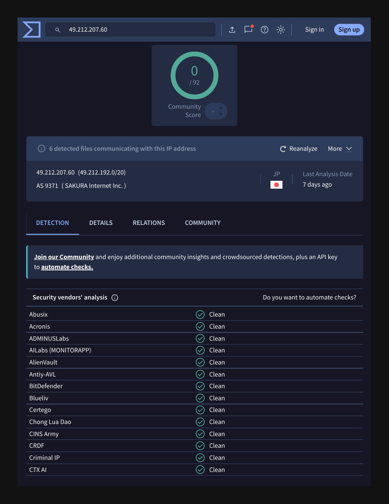

# Phishing Report 02: Hacking-Tools Spam from a Hacked Website

| Field | Value |
|---|---|
| Sample | `sample-1253.eml` (phishing_pot dataset) |
| Date received | Fri, 25 Nov 2022 08:00:01 +0900 |
| Category | Cybercrime advertising spam |
| Verdict | **Malicious spam** |
| Severity | Low (no credential lure or malware) |
| Impersonates | None: advertises "tools and accounts" |
| Related | Same theme as [report 04](email-04.md) |
| Analyst | Satvik Huse |

## 1. Summary
Spam selling hacking tools and stolen accounts, sent from the web server of a legitimate Japanese business (sanshin-ashiba.com) on Sakura Internet shared hosting. The headers show the message was created on the server itself, most likely by a malicious script uploaded to a hacked website.

## 2. Header analysis
| Header | Value | Finding |
|---|---|---|
| From | support@sanshin-ashiba.com | Legitimate business domain |
| Return-Path | support@sanshin-ashiba.com | Matches From |
| Reply-To | (none) | Contact details are in the body |
| Subject | Buy tools and accounts | Openly sells cybercrime goods |
| Sending server | www3050.sakura.ne.jp [49.212.207.60] | Shared web hosting, not a mail service |
| Received | from sanshin-ashiba@localhost ... Submit | Submitted locally on the server: likely a script |
| SPF / DKIM / DMARC | pass / none / none | No DKIM signature, no DMARC policy |

## 3. Enrichment
| Indicator | Tool | Result |
|---|---|---|
| 49.212.207.60 | VirusTotal (re-checked 2026-10-18) | 0/92; AS9371 SAKURA Internet, Japan |
| 49.212.207.60 | AbuseIPDB | No abuse reports |
| sanshin-ashiba.com | urlscan.io | Clean |
| Links in body | VirusTotal / urlscan.io | 0 detections at time of analysis |
| Attachments | grep | None |

VirusTotal's Relations tab lists 6 detected files that contact this IP. That is common for shared hosting, where many sites sit on one address, so it is context rather than proof.

## 4. IOCs
| Type | Value | Action |
|---|---|---|
| Email (sender) | support@sanshin-ashiba.com | Block sender address |
| Host / IP | www3050.sakura.ne.jp / 49.212.207.60 | Report to host; do not block whole shared IP |
| URLs in body | (scanned clean, 2022 sample) | Block at web proxy |

## 5. Red flags
- Subject openly sells "tools and accounts"
- Mail generated by a local script on a web server
- No DKIM and no DMARC policy
- Unsolicited and unrelated to the sending company's business

## 6. MITRE ATT&CK
| Technique | ID | Why |
|---|---|---|
| Compromise Infrastructure: Server | T1584.004 | A hacked website appears to be used to send mail |

## 7. Recommended actions
1. Delete from mailboxes and block the sender address
2. Block any URLs or contact handles in the body
3. Notify the domain owner and Sakura Internet abuse team that the site is sending spam
4. Low priority: no credential lure or malware

## 8. Evidence

*VirusTotal, 2026-10-18: no vendor flags the sending IP.*

## 9. Lesson learned
A clean reputation score is only a snapshot of today. Old samples and hacked legitimate sites often score 0, so headers and content must drive the verdict.

---
*Analysed safely: headers and text inspected with grep in an Ubuntu VM. No links clicked, no attachments opened.*
