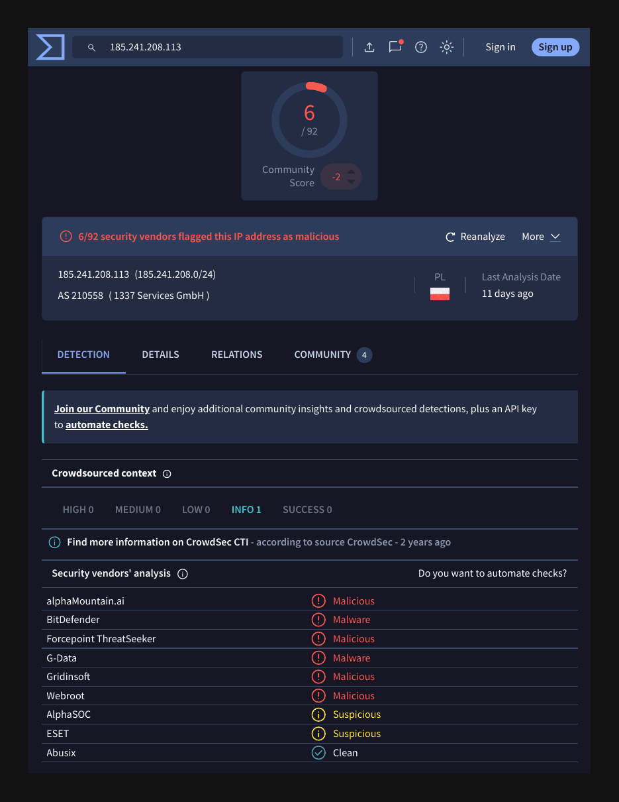

# Phishing Report 03: Dieter Schwarz Scam via Government Mailbox

| Field | Value |
|---|---|
| Sample | `sample-5379.eml` (phishing_pot dataset) |
| Date received | Fri, 04 Jul 2025 01:32:50 -0700 |
| Category | Advance-fee / donation scam |
| Verdict | **Malicious** |
| Severity | Medium (social engineering, flagged source IP) |
| Impersonates | Dieter Schwarz (Lidl / Schwarz Group owner) |
| Campaign | Same campaign as [report 01](email-01.md) |
| Analyst | Satvik Huse |

## 1. Summary
A Dieter Schwarz donation scam sent from a Pakistan Ministry of Interior mailbox (aodev@interior.gov.pk) that appears to be compromised. The attacker connected from 185.241.208.113, sent through the government's hosting provider, and redirected replies to Gmail. The same lure and Reply-To pattern as report 01 point to one ongoing campaign that rotates hijacked mailboxes.

## 2. Header analysis
| Header | Value | Finding |
|---|---|---|
| From | aodev@interior.gov.pk | Real government domain, likely compromised account |
| Return-Path | aodev@interior.gov.pk | Matches From |
| Reply-To | dieterschwarz787@gmail.com | **Mismatch**: free Gmail, attacker-controlled |
| Subject | [Spam] | Tagged as spam by a gateway on the way |
| Origin (first Received hop) | [185.241.208.113] port 62703 | Where the sender actually connected from |
| Relay | host201701.comsatshosting.com → symantec3.comsats.net.pk [210.56.11.6] | Legitimate Pakistani hosting / mail filter |
| SPF / DKIM / DMARC | pass / none / pass (p=none) | Real server sent it; p=none means no enforcement |

## 3. Enrichment
| Indicator | Tool | Result |
|---|---|---|
| 185.241.208.113 | VirusTotal (re-checked 2026-10-18) | **6/92** malicious (7/92 at first analysis); AS210558 1337 Services GmbH, Poland |
| interior.gov.pk | urlscan.io / VirusTotal | Clean, 11-year-old domain on Akamai; site geoblocks foreign visitors |
| 210.56.11.6 | Header review | Legitimate relay (symantec3.comsats.net.pk) |

Vendors flagging the origin IP on 2026-10-18: alphaMountain.ai, BitDefender, Forcepoint ThreatSeeker, G-Data, Gridinsoft, Webroot.

## 4. IOCs
| Type | Value | Action |
|---|---|---|
| Email (Reply-To) | dieterschwarz787@gmail.com | Block (primary IOC) |
| IP (origin) | 185.241.208.113 | Block at gateway / firewall |
| Email (sender) | aodev@interior.gov.pk | Monitor: likely compromised |

## 5. Campaign link to report 01
| | Report 01 | Report 03 |
|---|---|---|
| Lure | Dieter Schwarz donation | Dieter Schwarz donation |
| Reply-To | schwarzdieter709@gmail.com | dieterschwarz787@gmail.com |
| Sender | Brazilian company mailbox | Pakistani government mailbox |
| Auth checks | All passed | SPF and DMARC passed |

## 6. Red flags
- Reply-To differs from From and uses free Gmail
- Government ministry address sending a celebrity donation offer
- Gateway tagged the subject [Spam]
- Origin IP flagged by multiple security vendors

## 7. MITRE ATT&CK
| Technique | ID | Why |
|---|---|---|
| Phishing | T1566 | Social-engineering email to start a scam |
| Valid Accounts | T1078 | A real mailbox appears to have been used to send |

## 8. Recommended actions
1. Block and quarantine mail with Reply-To dieterschwarz787@gmail.com; hunt for other Gmail Reply-To addresses containing "dieter" or "schwarz"
2. Block 185.241.208.113 at the email gateway / firewall
3. Do not block interior.gov.pk (legitimate); notify their team that aodev@ appears compromised
4. If any user replied, find out what they shared

## 9. Evidence

*VirusTotal, 2026-10-18: 6 of 92 vendors flag the origin IP.*

## 10. Lesson learned
The first Received hop shows where the sender really connected from. Linking IOCs across emails (same lure, similar Reply-To) turns single alerts into a campaign, which is how SOC analysts find the bigger picture.

---
*Analysed safely: headers and text inspected with grep in an Ubuntu VM. No links clicked, no attachments opened.*
