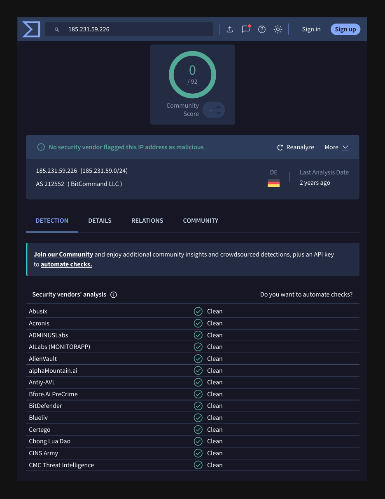

# Phishing Report 04: Black-Market Ad for Hacked Servers

| Field | Value |
|---|---|
| Sample | `sample-1247.eml` (phishing_pot dataset) |
| Date received | Sat, 05 Nov 2022 10:43:42 +0000 |
| Category | Cybercrime marketplace spam |
| Verdict | **Malicious spam** |
| Severity | Low (no lure targeting the reader) |
| Impersonates | None: display name "Omgo" |
| Related | Same theme as [report 02](email-02.md) |
| Analyst | Satvik Huse |

## 1. Summary
Spam advertising a "black market" that sells stolen access: web shells, hacked cPanel hosting accounts, hijacked SMTP mail servers and compromised RDP (remote desktop) logins. Sent from kipa-group.com through a third-party mail gateway (getway.biz). It targets no one directly, but shows how attackers buy footholds for later attacks.

## 2. Header analysis
| Header | Value | Finding |
|---|---|---|
| From | Omgo <info@kipa-group.com> | Display name unrelated to the domain |
| Return-Path | info@kipa-group.com | Matches From |
| Reply-To | (none) | Contact details are in the body |
| Subject | Best Black Market [shells,cpanels,smtps,rdps,..etc] | Openly sells criminal access |
| Sending server | mailgw5.getway.biz [185.231.59.226] | Third-party mail gateway |
| SPF / DKIM / DMARC | pass / none / none | No DKIM signature, no DMARC policy |

## 3. Enrichment
| Indicator | Tool | Result |
|---|---|---|
| 185.231.59.226 | VirusTotal (re-checked 2026-10-18) | 0/92; AS212552 BitCommand LLC, Germany; last full analysis 2 years old |
| kipa-group.com | VirusTotal / urlscan.io | Clean |

## 4. IOCs
| Type | Value | Action |
|---|---|---|
| Email (sender) | info@kipa-group.com | Block sender |
| Host / IP | mailgw5.getway.biz / 185.231.59.226 | Watchlist |

## 5. What is being sold
| Item | Meaning | Risk to a company |
|---|---|---|
| Shells | Web shells on hacked websites | Attacker control of a web server |
| cPanels | Hosting control-panel logins | Defacement, hosting phishing pages |
| SMTPs | Hijacked mail servers | Sending spam and phishing as you |
| RDPs | Remote desktop logins | Direct entry point for ransomware |

## 6. Red flags
- Subject openly advertises a "black market"
- Display name "Omgo" has no link to kipa-group.com
- No DKIM and no DMARC policy
- Unsolicited bulk mail

## 7. MITRE ATT&CK
| Technique | ID | Why |
|---|---|---|
| Acquire Access | T1650 | The marketplace sells initial access to buyers |

## 8. Recommended actions
1. Delete and block the sender
2. Block any shop URLs or contact handles in the body
3. Threat intel: make sure company RDP is not exposed to the internet and SMTP / cPanel accounts use MFA
4. Low priority: no lure targeting users

## 9. Evidence

*VirusTotal, 2026-10-18: no vendor flags the sending IP (stale analysis, 2 years old).*

## 10. Lesson learned
Not every malicious email targets the reader. Spam advertising criminal access shows what attackers trade, and why exposed RDP and weak hosting passwords end up for sale.

---
*Analysed safely: headers and text inspected with grep in an Ubuntu VM. No links clicked, no attachments opened.*
